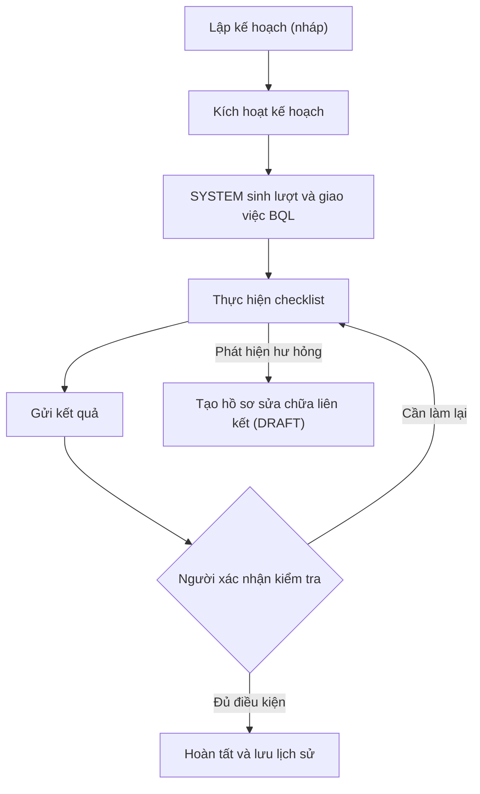

# Đặc tả triển khai demo web quản lý sửa chữa và bảo trì tòa nhà

Ngày cập nhật: 12/10/2026 — bản hợp nhất, cập nhật theo xác nhận của khách hàng ngày 12/10/2026: bỏ báo giá (chỉ ghi tên nhà thầu và giá), 4 tòa nhà, 7 vai trò, chuỗi duyệt đủ 4 vai trò TVKT/BQT/CSH/CĐT với thứ tự cấu hình theo từng tòa, nghiệm thu cần cả Kỹ thuật và TVKT, BQT duyệt thanh toán. Danh sách thay đổi ở Phụ lục B.

## 1. Mục tiêu và giả định

Xây dựng bản demo frontend dùng mock data, chạy xuyên suốt hai workflow: sửa chữa khi có hư hỏng và bảo trì định kỳ. Khách hàng dùng bản demo để xác nhận nghiệp vụ, giao diện và phạm vi trước khi xây dựng backend thật.

Tài liệu này bổ sung cho đề xuất dự án hiện tại. Các quy tắc dưới đây là giả định để demo có thể chạy nhất quán; những điểm khách hàng đã xác nhận ngày 12/10/2026 được ghi ở Phụ lục A (cột Trạng thái). TVKT (tư vấn kỹ thuật) và BQT (ban quản trị) là hai vai trò riêng; người đại diện cụ thể của từng vai trò vẫn cần khách hàng chỉ định trước khi cấu hình thật, demo dùng người giả định.

Giả định demo:

- 4 tòa nhà (A, B, C, D); 11 tài khoản (10 đang hoạt động, 1 ngừng hoạt động) gồm BQL, kỹ thuật, TVKT, BQT, chủ sở hữu, chủ đầu tư và quản trị demo.
- Sửa chữa: 20 hồ sơ; không có báo giá – tờ trình chỉ ghi tên nhà thầu thực hiện (gõ tự do) và giá; tờ trình duyệt tuần tự đủ 4 vai trò theo thứ tự cấu hình của tòa; người trình và chủ đầu tư ký bằng chữ ký vẽ (chuột hoặc cảm ứng); lần trình 3 bị từ chối thì hồ sơ “Chưa xử lý” và hệ thống soạn thông báo có lý do; cảnh báo theo quy tắc (còn bảo hành, mới sửa đã hỏng, hỏng lặp lại, giá cao bất thường); nghiệm thu cần cả Kỹ thuật và TVKT đạt; BQT duyệt thanh toán; tối đa 3 lần trình; một lần thanh toán đủ. Không có ngưỡng tiền.
- Bảo trì: 6 hạng mục, 6 kế hoạch, 13 lượt bảo trì; chu kỳ theo tháng; lượt được sinh trong trình duyệt, không có máy chủ chạy nền.

Số lượng demo không thay đổi phạm vi và báo giá triển khai thật. Phần bảo trì làm tăng phạm vi demo so với bản chỉ có sửa chữa; chi phí và lịch phát triển thật cần đánh giá lại, không tự coi đã nằm trong báo giá web sửa chữa trước đó.

## 2. Phạm vi và màn hình

| Màn hình | Chức năng phải có |
|---|---|
| Vào demo | Chọn tài khoản có sẵn; tài khoản ngừng hoạt động hiển thị nhưng không chọn được; ghi rõ đây là đăng nhập mô phỏng |
| Tổng quan | Số liệu từ dữ liệu thực trong demo; công việc chờ tôi; hồ sơ gần đây; bảo trì sắp đến hạn và quá hạn |
| Hồ sơ sửa chữa | Tìm mã/tên; lọc tòa nhà, trạng thái, vị trí, hạng mục, người phụ trách, ngày; phân trang |
| Tạo và sửa hồ sơ | Hạng mục bảo trì (tùy chọn), vị trí, mô tả, mức ưu tiên, ảnh/tệp; lưu nháp, gửi, rút hồ sơ |
| Chi tiết hồ sơ | Tổng quan, Tờ trình và phê duyệt (kèm tiến trình 4 bước duyệt), Thi công, Nghiệm thu, Thanh toán, Lịch sử; liên kết lượt bảo trì nguồn nếu có |
| Bảo trì › Hạng mục | Danh sách thiết bị/hạng mục theo tòa nhà, vị trí; mã, tên, loại, đầu mối, tình trạng, model, nhà cung cấp, ngày lắp/thay, hạn bảo hành, tài liệu thiết bị; tạo, sửa, vô hiệu hóa |
| Bảo trì › Kế hoạch | Chu kỳ, ngày gốc, checklist, người thực hiện/xác nhận, tên nhà thầu (gõ tự do); kích hoạt, tạm dừng, đổi lịch, tạo lượt bù |
| Bảo trì › Lịch | Dạng danh sách và lịch tháng; lọc tòa nhà, hạng mục, người phụ trách, trạng thái, ngày dự kiến; nút “Cập nhật lịch” |
| Bảo trì › Chi tiết lượt | Checklist, ghi chú, ảnh/tệp, đơn vị thực hiện, các lần gửi, kết quả kiểm tra, hồ sơ sửa chữa liên kết, lịch sử |
| Bảo trì › Lịch sử hạng mục | Các lượt bảo trì, phát hiện hư hỏng, thay đổi tình trạng và hồ sơ sửa chữa liên quan |
| Công việc của tôi | Tác vụ sửa chữa và bảo trì được giao; mỗi dòng ghi rõ loại “Sửa chữa”/“Bảo trì”; mở đúng hồ sơ/lượt và mục nội dung |
| Báo cáo | Tab Sửa chữa và tab Bảo trì theo mục 11.3; xuất CSV từng tab |
| Thông báo | Thông báo theo người nhận; đánh dấu đã đọc; mở hồ sơ/lượt |
| Quản trị demo | Tài khoản (tạo, sửa vai trò và tòa, ngừng hoạt động); vai trò (sao chép từ vai trò mẫu, sửa vai trò tự tạo); ma trận quyền; thay BQL quản lý khi BQL ngừng hoạt động; cấu hình độ trễ/lỗi; khôi phục dữ liệu demo |
| Tầng, khu vực, vị trí | Menu riêng: chọn tòa; tìm theo tên/khu vực/tầng; lọc tầng, trạng thái; thêm, sửa, ngừng dùng/dùng lại; lịch sử thay đổi vị trí |
| Tòa nhà và cấu hình | Chọn tòa trong phạm vi; số vị trí đang dùng (liên kết sang menu vị trí); cấu hình riêng (thời hạn xử lý, hạn mức và giờ bổ sung khẩn cấp, ngưỡng cảnh báo); áp dụng mẫu hoặc sao chép từ tòa khác có xem trước; lịch sử thay đổi; quản trị viên thêm và sửa tòa |

Các tính năng ngoài demo: đăng nhập bảo mật thật, gửi email/Zalo/SMS thật, ký số thật, chuyển tiền, danh mục nhà thầu, so sánh báo giá, cổng nhà thầu/cư dân, app riêng, offline, trình thiết kế quy trình, xuất biểu mẫu pháp lý hoàn chỉnh, chi phí/nghiệm thu/thanh toán hợp đồng bảo trì, chu kỳ theo tuần/ngày/giờ chạy máy, lịch nghỉ lễ. Chữ ký là chữ ký vẽ trong hệ thống, không có chứng thư số.

## 3. Vai trò và quyền

Ký hiệu: X = được làm; — = không được làm. Tất cả quyền nghiệp vụ chỉ áp dụng trong tòa nhà được gán. ADMIN không mặc định có quyền duyệt, xác nhận hoặc ký thay người nghiệp vụ.

Vai trò: ADMIN (quản trị demo), BQL (ban quản lý), KT (kỹ thuật – xác nhận hiện trạng, kiểm tra bảo trì), TVKT (tư vấn kỹ thuật), BQT (ban quản trị), CSH (chủ sở hữu), CĐT (chủ đầu tư).

| Hành động | ADMIN | BQL | KT | TVKT | BQT | CSH | CĐT |
|---|---|---|---|---|---|---|---|
| Xem hồ sơ, lượt bảo trì và tệp trong phạm vi | X | X | X | X | X | X | X |
| **Sửa chữa** | | | | | | | |
| Tạo/sửa nháp, bổ sung hồ sơ, rút hồ sơ | — | X | — | — | — | — | — |
| Gửi xác nhận, lập tờ trình (tên nhà thầu và giá) | — | X | — | — | — | — | — |
| Xác nhận cần sửa, trả bổ sung, đóng không cần sửa | — | — | X | — | — | — | — |
| Duyệt, yêu cầu bổ sung, từ chối tờ trình (đúng bước của mình) | — | — | — | X | X | X | X |
| Ký quyết định trên tờ trình đã duyệt (chữ ký vẽ) | — | — | — | — | — | — | X |
| Cập nhật thi công, lập đề nghị thanh toán | — | X | — | — | — | — | — |
| Ghi nhận nghiệm thu đạt/không đạt (cần cả KT và TVKT đạt) | — | — | X | X | — | — | — |
| Duyệt/trả đề nghị thanh toán | — | — | — | — | X | — | — |
| Ghi nhận thanh toán và đóng hoàn tất | — | X | — | — | — | — | — |
| **Bảo trì** | | | | | | | |
| Tạo/sửa/vô hiệu hóa hạng mục bảo trì | — | X | — | — | — | — | — |
| Tạo/sửa/kích hoạt/tạm dừng/đổi lịch kế hoạch | — | X | — | — | — | — | — |
| Kích hoạt sinh lịch tự động khi mở màn hình (chạy dưới danh nghĩa SYSTEM) | X | X | X | X | X | X | X |
| Bấm “Cập nhật lịch”, tạo lượt bù thủ công | — | X | — | — | — | — | — |
| Bắt đầu, cập nhật checklist, gửi kết quả, đổi lịch, hủy lượt | — | X | — | — | — | — | — |
| Tạo hồ sơ sửa chữa từ lượt bảo trì | — | X | — | — | — | — | — |
| Kiểm tra, yêu cầu làm lại, xác nhận hoàn tất lượt | — | — | X | — | — | — | — |
| Cập nhật tình trạng hạng mục | — | X | X (khi xác nhận lượt) | — | — | — | — |
| **Chung** | | | | | | | |
| Giao lại người xử lý hồ sơ/lượt | — | X | — | — | — | — | — |
| Thay BQL quản lý đang ngừng hoạt động | X | — | — | — | — | — | — |
| Cho sửa chữa khẩn cấp trong hạn mức | — | X | — | — | — | — | — |
| Cấu hình vị trí và cấu hình tòa trong phạm vi | X | X | — | — | — | — | — |
| Quản lý tài khoản, vai trò, thêm tòa nhà | X | — | — | — | — | — | — |
| Xem báo cáo | X | X | — | X | X | X | X |
| Xem quản trị và khôi phục demo | X | — | — | — | — | — | — |

Mỗi hồ sơ sửa chữa gán managerUserId, confirmationUserId (KT) và bốn người duyệt consultantUserId (TVKT), boardUserId (BQT), ownerUserId (CSH), investorUserId (CĐT) – mặc định lấy người đầu tiên còn hoạt động của từng vai trò trong tòa, BQL đổi được khi hồ sơ còn nháp; mỗi kế hoạch và lượt bảo trì gán managerUserId và confirmationUserId. Có quyền vai trò nhưng không được giao bước đó thì không được quyết định; ví dụ BQL khác trong cùng tòa không được thao tác hồ sơ không do mình quản lý. Không cho người lập tờ trình tự duyệt tờ trình của mình. Kiểm tra quyền tại lớp dịch vụ mock trước khi đổi dữ liệu, không chỉ ẩn nút.

Bản demo kiểm tra trải nghiệm phân quyền, không cung cấp ranh giới bảo mật thực tế; dữ liệu trong trình duyệt vẫn có thể bị sửa. Backend thật phải thực thi lại mọi quyền.

## 4. Cấu hình, danh mục và quy ước dữ liệu

Demo dùng chung một bộ trạng thái, quy trình, chuỗi duyệt đủ 4 bước, giới hạn 3 lần trình, định dạng tiền và giới hạn tệp cho mọi tòa nhà. Tài khoản, vị trí, hạng mục, người phụ trách và kế hoạch bảo trì được phân theo tòa nhà; một tài khoản có thể phụ trách nhiều tòa. Mỗi tòa có cấu hình riêng (BuildingConfig): thời hạn xử lý từng bước, thứ tự 4 vai trò duyệt, hạn mức và số giờ bổ sung hồ sơ khẩn cấp, ngưỡng cảnh báo; có 3 mẫu (Mẫu chung, Chung cư, Tòa văn phòng) và sao chép từ tòa khác. Hồ sơ lưu bản chụp thời hạn (dueDays) và thứ tự chuỗi duyệt lúc tạo nên đổi cấu hình không ảnh hưởng hồ sơ đang xử lý. Các trạng thái duyệt vẫn dùng chung; chỉ thứ tự bước được cấu hình.

Tòa nhà do quản trị viên chung thêm; vị trí do BQL của tòa hoặc quản trị viên quản lý (vị trí ngừng dùng vẫn hiển thị trên hồ sơ cũ nhưng không chọn được cho hồ sơ mới). Tài khoản và vai trò do quản trị viên chung quản lý: vai trò tự tạo được sao chép từ vai trò mẫu và chỉ được giữ hoặc bỏ quyền của vai trò gốc, không cấp thêm; tài khoản chỉ được gán tòa trong phạm vi của người quản trị. Không có danh mục nhà thầu: tên nhà thầu gõ tự do trên tờ trình, kế hoạch và kết quả bảo trì. Hạng mục bảo trì do BQL tạo/sửa trong tòa mình (mục 6.4).

Quy ước dữ liệu:

- Dùng ID ổn định để liên kết; mã hồ sơ/lượt chỉ để hiển thị, cấp duy nhất trong transaction.
- Thời điểm lưu ISO 8601 UTC, hiển thị theo Asia/Ho_Chi_Minh. Ngày không có giờ lưu YYYY-MM-DD; mọi so sánh “hôm nay”, quá hạn, sắp đến hạn tính theo múi giờ Việt Nam.
- Tiền lưu số nguyên VND, không lưu chuỗi định dạng; chặn giá trị vượt Number.MAX_SAFE_INTEGER. Backend thật dùng kiểu decimal/bigint.
- Mọi entity thay đổi được có version, createdAt, updatedAt; mọi thay đổi tăng version và tạo AuditEvent, kể cả khi trạng thái không đổi.
- Trạng thái sửa chữa và trạng thái bảo trì là hai kiểu riêng (RepairStatus, MaintenanceOccurrenceStatus); không dùng chung nhãn.

## 5. Workflow sửa chữa

### 5.1 Trạng thái

| Mã | Nhãn |
|---|---|
| DRAFT | Nháp |
| PENDING_CONFIRMATION | Chờ xác nhận |
| NEEDS_RECORD_UPDATE | Cần bổ sung thông tin |
| PENDING_PROPOSAL | Chờ lập tờ trình |
| EMERGENCY_IN_PROGRESS | Đang xử lý khẩn cấp (làm trước, bổ sung tờ trình trong số giờ cấu hình) |
| PENDING_TECH_REVIEW | Chờ TVKT thẩm định |
| PENDING_BOARD_APPROVAL | Chờ BQT duyệt |
| PENDING_OWNER_APPROVAL | Chờ chủ sở hữu duyệt |
| PENDING_INVESTOR_APPROVAL | Chờ chủ đầu tư duyệt |
| NEEDS_SUBMISSION_UPDATE | Cần bổ sung tờ trình |
| REJECTED_RESUBMITTABLE | Từ chối và được trình lại |
| PENDING_SIGNATURE | Chờ chủ đầu tư ký |
| READY_FOR_CONSTRUCTION | Chờ thi công |
| IN_CONSTRUCTION | Đang thi công |
| PENDING_ACCEPTANCE | Chờ nghiệm thu |
| NEEDS_REPAIR | Cần khắc phục |
| PENDING_PAYMENT_REQUEST | Chờ đề nghị thanh toán |
| PENDING_PAYMENT_APPROVAL | Chờ duyệt thanh toán |
| NEEDS_PAYMENT_UPDATE | Cần bổ sung thanh toán |
| PENDING_PAYMENT | Chờ thanh toán |
| COMPLETED | Hoàn tất |
| CLOSED_NO_REPAIR | Đóng vì không cần sửa |
| UNRESOLVED | Chưa xử lý (bị từ chối ở lần trình 3; còn bước phát hành thông báo) |
| CLOSED_WITHDRAWN | Đóng do rút hồ sơ |

### 5.2 Chuyển bước

| Từ trạng thái | Lệnh | Người được giao | Điều kiện | Đến trạng thái |
|---|---|---|---|---|
| DRAFT, NEEDS_RECORD_UPDATE | submitRecord | BQL quản lý | Đủ validation mục 5.4; ít nhất 1 ảnh hiện trường | PENDING_CONFIRMATION |
| PENDING_CONFIRMATION | requestRecordUpdate | KT | Có lý do; tạo RepairConfirmation | NEEDS_RECORD_UPDATE |
| PENDING_CONFIRMATION | confirmRepair | KT | Có kết luận hiện trạng; tạo RepairConfirmation | PENDING_PROPOSAL |
| PENDING_CONFIRMATION | closeNoRepair | KT | Có lý do; tạo RepairConfirmation | CLOSED_NO_REPAIR |
| DRAFT, NEEDS_RECORD_UPDATE, PENDING_PROPOSAL, NEEDS_SUBMISSION_UPDATE, REJECTED_RESUBMITTABLE | withdrawRecord | BQL quản lý | Có lý do; giữ toàn bộ lịch sử | CLOSED_WITHDRAWN |
| DRAFT, PENDING_CONFIRMATION, PENDING_PROPOSAL | startEmergencyRepair | BQL quản lý (quyền EMERGENCY_START) | Đủ điều kiện gửi hồ sơ (ảnh, vị trí); lý do; nhà thầu; chi phí dự kiến ≤ hạn mức khẩn cấp của tòa; tạo Construction, ghi hạn bổ sung = bây giờ + số giờ cấu hình; thông báo KT và 4 người duyệt | EMERGENCY_IN_PROGRESS |
| EMERGENCY_IN_PROGRESS | submitProposal | BQL quản lý | Như trình thông thường; quá hạn bổ sung thì bắt buộc lý do trễ (lateReason) | PENDING_TECH_REVIEW |
| PENDING_PROPOSAL | submitProposal | BQL quản lý | Phương án, tên nhà thầu, giá, tài liệu tờ trình, chữ ký người trình; 4 người duyệt còn hoạt động | PENDING_TECH_REVIEW |
| NEEDS_SUBMISSION_UPDATE, REJECTED_RESUBMITTABLE | resubmitProposal | BQL quản lý | Đủ điều kiện trình; tạo lần trình mới, không ghi đè bản cũ; chuỗi duyệt bắt đầu lại từ TVKT | PENDING_TECH_REVIEW |
| PENDING_TECH_REVIEW | approveProposal | TVKT | Lần trình còn hiệu lực | PENDING_BOARD_APPROVAL |
| PENDING_BOARD_APPROVAL | approveProposal | BQT | Lần trình còn hiệu lực | PENDING_OWNER_APPROVAL |
| PENDING_OWNER_APPROVAL | approveProposal | CSH | Lần trình còn hiệu lực | PENDING_INVESTOR_APPROVAL |
| PENDING_INVESTOR_APPROVAL | approveProposal | CĐT | Lần trình còn hiệu lực; khóa số tiền | PENDING_SIGNATURE |
| Một trong 4 bước duyệt | requestProposalUpdate | Người duyệt của bước đó | Có lý do; lần trình < 3 | NEEDS_SUBMISSION_UPDATE |
| Một trong 4 bước duyệt | requestProposalUpdate | Người duyệt của bước đó | Lần trình = 3 | Chặn; chỉ được duyệt hoặc từ chối |
| Một trong 4 bước duyệt | rejectProposal | Người duyệt của bước đó | Có lý do; lần trình < 3 | REJECTED_RESUBMITTABLE |
| Một trong 4 bước duyệt | rejectProposal | Người duyệt của bước đó | Có lý do; lần trình = 3; hệ thống soạn UnresolvedNotice (DRAFT) gồm lý do của cả 3 lần trình | UNRESOLVED |
| UNRESOLVED | saveUnresolvedNotice | BQL quản lý | Thông báo còn DRAFT; tiêu đề 5–200, nội dung 20–5.000 ký tự | UNRESOLVED |
| UNRESOLVED | issueUnresolvedNotice | BQL quản lý | Thông báo còn DRAFT; khóa nội dung, ghi noticeIssuedAt, thông báo trong hệ thống tới TVKT/BQT/CSH/CĐT; không gửi Zalo/email thật | UNRESOLVED |
| PENDING_SIGNATURE | signProposal | CĐT | Chữ ký vẽ (ảnh) gắn lần trình đã duyệt | READY_FOR_CONSTRUCTION |
| READY_FOR_CONSTRUCTION | startConstruction | BQL quản lý | Ngày bắt đầu và dự kiến hoàn thành hợp lệ | IN_CONSTRUCTION |
| IN_CONSTRUCTION | submitAcceptance | BQL quản lý | Tiến độ 100%, ngày hoàn thành, ảnh kết quả | PENDING_ACCEPTANCE |
| PENDING_ACCEPTANCE | failAcceptance | KT hoặc TVKT chưa quyết định ở lượt này | Có nội dung chưa đạt; một người không đạt là cả lượt không đạt | NEEDS_REPAIR |
| NEEDS_REPAIR | resubmitAcceptance | BQL quản lý | Có nội dung khắc phục và ảnh; tạo lượt nghiệm thu mới, cả KT và TVKT phải quyết định lại | PENDING_ACCEPTANCE |
| PENDING_ACCEPTANCE | passAcceptance | KT hoặc TVKT chưa quyết định ở lượt này | Có kết luận đạt; KT phải kèm biên bản, TVKT tùy chọn. Người đạt đầu tiên: hồ sơ vẫn chờ người còn lại | PENDING_ACCEPTANCE hoặc PENDING_PAYMENT_REQUEST (khi cả hai đạt) |
| PENDING_PAYMENT_REQUEST, NEEDS_PAYMENT_UPDATE | submitPaymentRequest | BQL quản lý | Số tiền đúng giá trị duyệt; có đề nghị và biên bản đạt; tạo revision mới | PENDING_PAYMENT_APPROVAL |
| PENDING_PAYMENT_APPROVAL | requestPaymentUpdate | BQT | Có lý do | NEEDS_PAYMENT_UPDATE |
| PENDING_PAYMENT_APPROVAL | approvePayment | BQT | Đủ hồ sơ, revision đề nghị hiện hành | PENDING_PAYMENT |
| PENDING_PAYMENT | recordPayment | BQL quản lý | Đủ số tiền, ngày, mã tham chiếu và chứng từ | PENDING_PAYMENT |
| PENDING_PAYMENT | completeRecord | BQL quản lý | Đã thanh toán đủ; đủ ký, nghiệm thu đạt và chứng từ bắt buộc | COMPLETED |

recordPayment và completeRecord là hai lệnh riêng để người dùng rà soát trước khi đóng hồ sơ. Chặn thanh toán lần hai cho cùng đề nghị trong giả định một lần thanh toán. Hồ sơ hoàn tất/đóng chỉ được xem; chưa có lệnh mở lại. withdrawRecord không được dùng sau khi đã duyệt; dừng việc sau duyệt là ngoại lệ chưa triển khai.

Chuỗi duyệt luôn đi đủ 4 bước theo thứ tự, không phụ thuộc số tiền (không có ngưỡng tiền). Người duyệt chỉ quyết định được ở bước của mình; trong lúc chờ một bước, các bước sau chưa thao tác được. Mỗi bước tạo ApprovalDecision có ghi step.

Sửa chữa khẩn cấp: trong lúc EMERGENCY_IN_PROGRESS, BQL cập nhật nhật ký thi công và soạn tờ trình; tờ trình vẫn đi đủ 4 bước; chủ đầu tư ký xong thì hồ sơ về IN_CONSTRUCTION (không qua “Chờ thi công”). Giá trình vượt hạn mức khẩn cấp có cảnh báo. Không có bước KT xác nhận hiện trạng cho hồ sơ khẩn cấp; KT vẫn nghiệm thu.

Ngoại lệ chưa triển khai: thay đổi giá/nhà thầu sau duyệt, hủy sau duyệt, bỏ qua ký, bỏ qua bước duyệt, ủy quyền, chuỗi duyệt khác nhau theo tòa. Khi thao tác liên quan xuất hiện, hiển thị rõ cần xác nhận yêu cầu; không tự cho đi tắt.

### 5.3 Nhập và sửa dữ liệu

| Lệnh | Người có quyền và trạng thái | Quy tắc |
|---|---|---|
| createRecord | BQL trong tòa | Tạo DRAFT, managerUserId là người tạo; cấp code duy nhất trong transaction |
| saveRecordDraft | BQL quản lý; DRAFT/NEEDS_RECORD_UPDATE | Lưu thông tin, tệp; chưa yêu cầu đủ như khi gửi |
| saveProposalDraft | BQL quản lý; PENDING_PROPOSAL/NEEDS_SUBMISSION_UPDATE/REJECTED_RESUBMITTABLE | Lưu phương án, tên nhà thầu (tối đa 200 ký tự), giá (có thể để trống khi lưu nháp) và tài liệu; chưa tạo Submission hoặc tăng attemptNo |
| updateConstruction | BQL quản lý; IN_CONSTRUCTION | Tiến độ nguyên 0–100, nhật ký và ảnh; ngày hoàn thành không trước ngày bắt đầu |
| saveRepairEvidence | BQL quản lý; NEEDS_REPAIR | Ghi nội dung khắc phục và ảnh trước khi gửi nghiệm thu lại |
| savePaymentDraft | BQL quản lý; PENDING_PAYMENT_REQUEST/NEEDS_PAYMENT_UPDATE | Lưu bản làm việc; gửi mới tạo revision và giữ bản cũ |

Mỗi hồ sơ có tối đa một ProposalDraft và một PaymentDraft hiện hành. Submission lưu snapshot phương án, tên nhà thầu, số tiền và tài liệu; sửa bản nháp sau đó không làm đổi dữ liệu lần trình cũ. Tên nhà thầu và giá sửa được đến khi trình; đã trình thì khóa theo lần trình.

### 5.4 Validation

- Tên hồ sơ: 3–120 ký tự. Mô tả hư hỏng: 10–2.000 ký tự khi gửi. Lý do bổ sung, từ chối, rút, hủy, đổi lịch, giao lại: 5–1.000 ký tự.
- priority = LOW/NORMAL/HIGH/URGENT; URGENT chỉ là mức ưu tiên, không cho bỏ qua duyệt.
- Gửi hồ sơ phải có tòa, vị trí đúng tòa, hạng mục bảo trì (nếu chọn) đúng tòa, người quản lý, KT và 4 người duyệt (TVKT, BQT, CSH, CĐT) còn hoạt động, đúng vai trò và cùng tòa, ít nhất một ảnh hiện trường. Người xác nhận phải khác người quản lý. Hồ sơ hiện có không đổi buildingId; chuyển tòa ngoài phạm vi demo.
- Gửi tờ trình phải có phương án tối thiểu 10 ký tự, tên nhà thầu, giá là số nguyên dương VND và tài liệu tờ trình. Giá trị trình và thanh toán dùng số tiền snapshot được duyệt. Không thay đổi số tiền sau duyệt.
- Ngày thanh toán không được ở tương lai; có mã tham chiếu và chứng từ. Tổng tiền thanh toán không vượt số được duyệt. Demo chỉ thanh toán một lần đúng đủ; nhiều đợt ngoài phạm vi.

## 6. Workflow bảo trì định kỳ

### 6.1 Phạm vi

Bảo trì là công việc chủ động theo lịch hoặc kế hoạch, khác với hồ sơ sửa chữa phát sinh khi có hư hỏng. Demo quản lý hạng mục/thiết bị cần bảo trì, kế hoạch định kỳ, các lượt thực hiện, checklist, kết quả và lịch sử. Các chu kỳ, checklist, người thực hiện và yêu cầu kiểm tra là giả định demo cần khách hàng xác nhận.

Không mặc định mỗi lượt bảo trì phải lập tờ trình hoặc đi qua workflow sửa chữa. Khi cần mua sắm hoặc sửa hỏng có chi phí, tạo hồ sơ sửa chữa liên kết và áp dụng quy trình mục 5. Chi phí dịch vụ bảo trì theo hợp đồng, nghiệm thu và thanh toán định kỳ chưa nằm trong demo; cần khảo sát riêng.

Demo chưa có tài khoản nhà thầu: BQL cập nhật thay người thực hiện ngoài hệ thống và bắt buộc ghi tên đơn vị thực hiện (performerName; tên nhà thầu gõ tự do nếu có). TVKT, BQT, CSH và CĐT chỉ xem bảo trì trong phạm vi tòa, không có quyết định bảo trì. ADMIN chỉ quản trị theo quyền ở mục 3.



### 6.2 Trạng thái kế hoạch và lượt

Kế hoạch: DRAFT = Nháp; ACTIVE = Đang hoạt động; PAUSED = Tạm dừng. Chỉ kế hoạch ACTIVE được sinh lượt tự động.

| Mã lượt | Nhãn |
|---|---|
| SCHEDULED | Đã lên lịch |
| IN_PROGRESS | Đang thực hiện |
| PENDING_REVIEW | Chờ kiểm tra |
| REWORK | Cần làm lại |
| COMPLETED | Đã hoàn thành |
| CANCELLED | Đã hủy |

Chỉ báo (không phải trạng thái):

- Sắp đến hạn: SCHEDULED có scheduledDate từ hôm nay đến hôm nay + 7 ngày.
- Quá hạn: scheduledDate trước hôm nay và status thuộc SCHEDULED/IN_PROGRESS/REWORK. Lượt PENDING_REVIEW không tính quá hạn vì đã gửi kết quả; hiển thị “Chờ kiểm tra” và số ngày chờ.
- Hoàn thành trễ: COMPLETED có ngày của completedAt (giờ Việt Nam) sau scheduledDate.

### 6.3 Chuyển bước lượt bảo trì

| Trạng thái nguồn | Lệnh | Người thực hiện | Điều kiện | Trạng thái đích |
|---|---|---|---|---|
| Chưa có lượt | generateOccurrences | SYSTEM (mục 6.5) | Kế hoạch ACTIVE; ngày thuộc khoảng sinh; chưa có khóa planId + originalScheduledDate | SCHEDULED |
| Chưa có lượt | createManualOccurrence | BQL quản lý kế hoạch | Kế hoạch ACTIVE/PAUSED; ngày và lý do hợp lệ; occurrenceKind=MANUAL | SCHEDULED |
| SCHEDULED | rescheduleMaintenance | BQL quản lý lượt | Ngày mới hợp lệ và có lý do; giữ originalScheduledDate | SCHEDULED |
| SCHEDULED | startMaintenance | BQL quản lý lượt | Người xác nhận còn hoạt động | IN_PROGRESS |
| IN_PROGRESS, REWORK | submitMaintenance | BQL quản lý lượt | Validation mục 6.6; tạo MaintenanceSubmission mới | PENDING_REVIEW |
| PENDING_REVIEW | requestMaintenanceRework | Người xác nhận của lượt | Có lý do; tạo MaintenanceReview REWORK | REWORK |
| PENDING_REVIEW | confirmMaintenance | Người xác nhận của lượt | Bản gửi hiện hành đủ; mọi mục ISSUE có hướng xử lý; tạo MaintenanceReview CONFIRMED; có thể cập nhật tình trạng hạng mục kèm ghi chú | COMPLETED |
| SCHEDULED, IN_PROGRESS, REWORK | cancelMaintenance | BQL quản lý lượt | Có lý do; lưu lịch sử | CANCELLED |
| IN_PROGRESS, PENDING_REVIEW, REWORK | createRepairFromMaintenance | BQL quản lý lượt | Mô tả, vị trí, ảnh hư hỏng; KT còn hoạt động; 4 người duyệt lấy mặc định theo tòa (kiểm tra khi trình) | Không đổi trạng thái lượt; tạo RepairRecord DRAFT liên kết |

Phát hiện ISSUE không tự hoàn tất hoặc tự chuyển sang sửa chữa. BQL có thể tạo hồ sơ sửa chữa và vẫn gửi kết quả bảo trì. Người xác nhận chỉ hoàn tất lượt khi các mục bắt buộc đã kiểm tra và mỗi mục ISSUE có hướng xử lý được ghi nhận (hồ sơ sửa chữa liên kết hoặc ghi chú xử lý); hồ sơ sửa chữa có vòng đời riêng, không bắt buộc đã hoàn tất. Phát hiện hư hỏng sau khi lượt đã COMPLETED thì tạo hồ sơ sửa chữa thường và chọn hạng mục.

Gửi lại, kiểm tra, xác nhận, đổi lịch và hủy đều tạo audit. Mỗi lần gửi là một MaintenanceSubmission bất biến; MaintenanceReview chỉ áp dụng cho bản gửi hiện hành. Khi làm lại, BQL sửa bản làm việc rồi gửi bản tiếp theo; bản cũ và review cũ giữ nguyên. completedAt chỉ ghi khi xác nhận hoàn tất; không mở lại lượt đã hoàn tất trong demo.

### 6.4 Nhập và sửa dữ liệu bảo trì

| Lệnh | Người có quyền và trạng thái | Quy tắc |
|---|---|---|
| createMaintenanceItem | BQL trong tòa | Mã duy nhất theo tòa; tên 3–120 ký tự; vị trí cùng tòa; đầu mối là BQL cùng tòa; condition=UNKNOWN |
| updateMaintenanceItem | BQL trong tòa; hạng mục active | Không đổi buildingId; model/nhà cung cấp ≤ 120 ký tự; ngày lắp và hạn bảo hành hợp lệ, hạn bảo hành không trước ngày lắp; tăng version |
| setItemDocuments | BQL trong tòa; hạng mục active | Danh sách tệp ITEM_DOCUMENT đã tải lên hạng mục |
| deactivateMaintenanceItem | BQL trong tòa | Không có kế hoạch ACTIVE; có lý do; không xóa lượt cũ; không xóa hạng mục có lịch sử |
| updateItemCondition | BQL trong tòa, hoặc người xác nhận qua confirmMaintenance | condition = UNKNOWN/GOOD/NEEDS_ATTENTION; bắt buộc ghi chú; không tự chuyển GOOD khi một hồ sơ sửa chữa hoàn tất |
| createMaintenancePlan | BQL trong tòa | Hạng mục active cùng tòa; tạo DRAFT, managerUserId là người tạo; đủ chu kỳ, ngày gốc, checklist và người xác nhận |
| updateMaintenancePlan | BQL quản lý kế hoạch | DRAFT: sửa tự do. ACTIVE/PAUSED: đổi checklist, người được giao, tên nhà thầu chỉ áp dụng cho lượt sinh sau đó; đổi chu kỳ dùng changeMaintenanceSchedule |
| activateMaintenancePlan | BQL quản lý kế hoạch; DRAFT/PAUSED | Hạng mục active; người được giao còn hoạt động; áp dụng quy tắc kích hoạt lại mục 6.5 |
| pauseMaintenancePlan | BQL quản lý kế hoạch; ACTIVE | Có lý do; lưu pausedAt |
| changeMaintenanceSchedule | BQL quản lý kế hoạch; ACTIVE/PAUSED | Tạo scheduleVersion mới với effectiveFrom không trước hôm nay |
| saveMaintenanceProgress | BQL quản lý lượt; IN_PROGRESS/REWORK | Cập nhật kết quả checklist của lượt, ghi chú, đơn vị thực hiện và tệp |

Checklist của lượt là snapshot từ kế hoạch lúc sinh lượt; BQL chỉ trả lời các mục, không thêm/bớt mục trên lượt. Muốn đổi checklist thì sửa kế hoạch; thay đổi áp dụng cho lượt sinh sau.

### 6.5 Sinh lịch và chống sinh trùng

Nguồn lịch duy nhất là MaintenancePlan.scheduleVersions[]. Mỗi phiên bản {revision, effectiveFrom, anchorDate, frequency, intervalMonths} sinh ngày lịch từ anchorDate và chỉ lấy các ngày thuộc khoảng hiệu lực của phiên bản. frequency quyết định intervalMonths: MONTHLY=1, QUARTERLY=3, SEMI_ANNUAL=6, YEARLY=12; không cho nhập giá trị mâu thuẫn. Ngày kế tiếp hiển thị trên kế hoạch là giá trị tính ra, không dùng làm nguồn sinh lịch.

Chu kỳ tính theo ngày gốc, không theo ngày hoàn thành lượt trước. Kỳ thứ n = anchorDate + n × intervalMonths tháng. Nếu ngày gốc là 29–31 mà tháng đích không có ngày đó, dùng ngày cuối tháng; các kỳ sau vẫn tính từ ngày gốc.

Kích hoạt sinh lịch:

- Khi bất kỳ người dùng nào mở Tổng quan hoặc menu Bảo trì, dịch vụ chạy generateOccurrences cho các tòa trong phạm vi người đó. Người thực hiện ghi là SYSTEM, AuditEvent lưu triggeredBy là tài khoản đang mở. Đây là thao tác không phụ thuộc quyền nghiệp vụ của người mở và chạy lặp không sinh trùng.
- BQL có thể bấm “Cập nhật lịch” để chạy cùng thao tác cho tòa của mình.
- Demo không giả lập máy chủ chạy nền khi trình duyệt đã đóng.

Khoảng sinh: mỗi kế hoạch có con trỏ generatedThrough. Mỗi lần chạy sinh các kỳ có ngày sau generatedThrough và không quá hôm nay + 30 ngày, rồi cập nhật generatedThrough. Giới hạn 100 lượt cho toàn transaction; nếu chạm giới hạn, lưu generatedThrough tại kỳ cuối cùng đã sinh, thông báo còn lịch chưa sinh, lần chạy sau tiếp tục từ đó. Khóa duy nhất planId + originalScheduledDate cho lượt SCHEDULED kind, kiểm tra trong transaction. Mỗi lượt được sinh tạo task cho BQL quản lý với dueAt = scheduledDate.

Tạm dừng và kích hoạt lại: tạm dừng chỉ ngừng sinh lượt mới; lượt đã sinh vẫn xử lý bình thường hoặc hủy riêng có lý do. Khi kích hoạt lại, các kỳ chưa từng sinh rơi vào khoảng tạm dừng được ghi vào skippedPeriods với lý do PAUSED, không tự tạo hàng loạt việc quá hạn; kỳ trước pausedAt mà chưa sinh vẫn được sinh bù. BQL có thể tạo lượt bù thủ công (occurrenceKind=MANUAL), không chiếm khóa của kỳ tự động.

Đổi lịch một lượt không đổi chu kỳ của kế hoạch; originalScheduledDate giữ nguyên nên không bị sinh lại. Đổi chu kỳ lập scheduleVersion mới; không sửa ngày hoặc checklist của lượt đã sinh. Từ effectiveFrom chỉ sinh theo phiên bản mới; các lượt SCHEDULED theo phiên bản cũ có ngày từ effectiveFrom trở đi được gắn reviewFlag=SCHEDULE_CHANGED để BQL rà soát/hủy riêng, tránh âm thầm mất lịch.

### 6.6 Validation bảo trì

- Tên hạng mục/kế hoạch: 3–120 ký tự. Lý do theo mục 5.4.
- Checklist kế hoạch có ít nhất 1 mục bắt buộc; nhãn 3–200 ký tự; ID mục duy nhất trong kế hoạch.
- Gửi kết quả: mọi mục bắt buộc khác NOT_CHECKED; ISSUE và NOT_APPLICABLE bắt buộc có ghi chú; có kết luận; có đơn vị thực hiện; ít nhất 1 ảnh. Mục không bắt buộc để NOT_CHECKED được hiển thị là “Không kiểm tra” và không chặn gửi.
- Ngày đổi lịch hoặc lượt bù: định dạng YYYY-MM-DD, không trước hôm nay.
- Người xác nhận của kế hoạch/lượt phải khác người quản lý, đúng vai trò, cùng tòa, còn hoạt động.

## 7. Giao việc, giao lại và tài khoản ngừng hoạt động

Gán task theo trạng thái:

- KT: PENDING_CONFIRMATION (sửa chữa); PENDING_REVIEW (bảo trì).
- KT và TVKT: PENDING_ACCEPTANCE – mỗi người một task; người đã đạt được đóng task, người còn lại giữ task đến khi quyết định.
- TVKT: PENDING_TECH_REVIEW. BQT: PENDING_BOARD_APPROVAL, PENDING_PAYMENT_APPROVAL. CSH: PENDING_OWNER_APPROVAL. CĐT: PENDING_INVESTOR_APPROVAL, PENDING_SIGNATURE.
- BQL quản lý: các bước còn mở khác, gồm SCHEDULED, IN_PROGRESS, REWORK của bảo trì.
- DRAFT chưa có task đến hạn; hồ sơ/lượt kết thúc không có task OPEN.

Đóng task cũ và mở task bước tiếp theo trong cùng transaction với lệnh. Không tạo trùng task OPEN cùng chủ thể, kind và người được giao. Task.kind dùng danh mục ở mục 8.1.

Giao lại: BQL quản lý dùng reassignRepair (KT hoặc một trong 4 người duyệt) / reassignMaintenance với lý do; chỉ chọn người còn hoạt động, đúng vai trò và cùng tòa. Không giao lại hồ sơ/lượt đã hoàn tất hoặc đóng. Giữ nguyên người và quyết định trong lịch sử; chỉ đổi người của bước hiện hành và các bước chưa diễn ra. Task cũ đóng với completionReason=REASSIGNED; mở task mới, thông báo cho người mới và audit. Nếu không có ứng viên hợp lệ, nút giao lại bị vô hiệu kèm lý do “Không có người cùng vai trò trong tòa”.

Quản trị viên ngừng hoạt động tài khoản trong Quản trị demo; các việc đang mở của người đó được tính lại ngay. Nếu người được giao inactive, chặn quyết định, hiển thị “Cần phân công lại” và tạo task REASSIGN_REQUIRED cho BQL quản lý. Nếu chính BQL quản lý inactive, ADMIN dùng replaceManager theo tòa với lý do; quyền này chỉ để khôi phục phân công, không cho ADMIN duyệt hoặc xác nhận thay.

## 8. Hợp đồng dữ liệu mock

### 8.1 Dùng chung

| Entity | Trường chính |
|---|---|
| User | id, code, fullName, role=ADMIN/BQL/TECH_CONFIRMER/TECH_CONSULTANT/OWNERS_BOARD/OWNER/INVESTOR, buildingIds[], active, roleDefId?, capabilities? (quyền của vai trò tự tạo) |
| RoleDefinition | id, code, name, baseRole, capabilities[], isSystem, sourceRoleId?, version |
| BuildingConfig | buildingId, templateKey?, taskDueDays, emergencyLimitVnd, emergencyDocHours, recentRepairDays, repeatMinRecords, priceRatio, version, updatedAt, updatedBy |
| Building | id, name, address |
| Location | id, buildingId, floor, zone?, name, active? |
| Attachment | id, subjectType, subjectId, buildingId, purpose, fileName, mimeType, sizeBytes, contentRef, uploadedBy, createdAt |
| AuditEvent | id, subjectType, subjectId, buildingId, commandId, action, actorId (hoặc SYSTEM), triggeredBy?, fromStatus?, toStatus?, entityVersion, reason?, createdAt |
| Task | id, subjectType, subjectId, buildingId, assigneeId, kind, status=OPEN/DONE, dueAt?, createdAt, completedAt?, completionReason?=COMPLETED/REASSIGNED/CANCELLED/CLOSED |
| Notification | id, subjectType, subjectId, buildingId, recipientId, title, message, createdAt, readAt? |
| CommandLog | commandId, actorId, action, payloadHash, result, createdAt |

subjectType = REPAIR_RECORD/MAINTENANCE_OCCURRENCE/MAINTENANCE_PLAN/MAINTENANCE_ITEM. Luôn lưu buildingId, kiểm tra subject tồn tại cùng tòa; mỗi bản ghi chỉ có một chủ thể chính. Không tạo hồ sơ sửa chữa giả để lưu tệp bảo trì.

Attachment.purpose = SITE_PHOTO/QUOTE/PROPOSAL/CONSTRUCTION/ACCEPTANCE/PAYMENT_REQUEST/PAYMENT_PROOF/MAINTENANCE_RESULT/OTHER. Entity nghiệp vụ lưu attachmentIds và có thể tham chiếu lại tệp của cùng chủ thể; không cấp quyền chỉ dựa trên ID tệp.

Task.kind = UPDATE_RECORD, CONFIRM_RECORD, PREPARE_PROPOSAL, APPROVE_PROPOSAL, SIGN_PROPOSAL, START_CONSTRUCTION, UPDATE_CONSTRUCTION, REVIEW_ACCEPTANCE, FIX_DEFECT, PREPARE_PAYMENT_REQUEST, APPROVE_PAYMENT, RECORD_PAYMENT, PERFORM_MAINTENANCE, REVIEW_MAINTENANCE, REWORK_MAINTENANCE, REVIEW_SCHEDULE_CHANGE, REASSIGN_REQUIRED.

### 8.2 Sửa chữa

| Entity | Trường chính |
|---|---|
| RepairRecord | id, code, buildingId, locationId, maintenanceItemId?, sourceMaintenanceOccurrenceId?, title, description, priority, status, managerUserId, confirmationUserId, dueDays?, emergency? (startedAt, startedBy, reason, estimatedAmountVnd, contractorName, limitVnd, docsDueAt, docsSubmittedAt?, lateReason?), consultantUserId, boardUserId, ownerUserId, investorUserId, pendingAcceptanceSlots?, currentSubmissionId?, approvedSubmissionId?, attachmentIds[], createdBy, createdAt, updatedAt, dueAt?, closedAt?, version |
| RepairConfirmation | id, recordId, actorId, outcome=CONFIRMED/NEEDS_UPDATE/NO_REPAIR, note, createdAt |
| ProposalDraft | id, recordId, proposal, contractorName, amountVnd?, attachmentIds[], version, updatedAt |
| Submission | id, recordId, attemptNo, proposal, contractorName, amountVnd, attachmentIds[], submittedBy, submittedAt |
| ApprovalDecision | id, submissionId, recordId, step=TECH/BOARD/OWNER/INVESTOR, actorId, outcome=APPROVED/NEEDS_UPDATE/REJECTED, reason?, createdAt |
| ProposalSignature | id, recordId, submissionId, attemptNo, kind=SUBMITTER/INVESTOR, actorId, imageDataUrl, signedAt |
| UnresolvedNotice | id, recordId, buildingId, title, body, status=DRAFT/ISSUED, version, createdAt, updatedAt, issuedAt?, issuedBy? |
| Construction | id, recordId, startDate, plannedEndDate, completedDate?, progressPercent, logs[] |
| ConstructionLog | id, actorId, note, progressPercent, attachmentIds[], createdAt |
| Acceptance | id, recordId, roundNo, submittedBy, submittedAt, submissionNote, result=PENDING/PASSED/FAILED, checks[] (reviewer=confirmer/consultant, actorId, passed, note, reportAttachmentIds[], checkedAt), attachmentIds[] |
| PaymentDraft | id, recordId, amountVnd, attachmentIds[], version, updatedAt |
| PaymentRequest | id, recordId, revisionNo, amountVnd, attachmentIds[], submittedBy, submittedAt, decision?=APPROVED/NEEDS_UPDATE, decidedBy?, decidedAt?, reason? |
| Payment | id, paymentRequestId, recordId, amountVnd, paidDate, reference, attachmentIds[], recordedBy, createdAt |

approvedAt lấy từ ApprovalDecision có outcome=APPROVED, không dựa vào updatedAt hồ sơ.

### 8.3 Bảo trì

| Entity | Trường chính |
|---|---|
| MaintenanceItem | id, code, buildingId, locationId, name, type, description?, ownerUserId, model?, supplier?, installDate?, warrantyUntil?, documentIds[], condition=UNKNOWN/GOOD/NEEDS_ATTENTION, active, version, createdAt, updatedAt |
| MaintenancePlan | id, code, itemId, buildingId, title, status=DRAFT/ACTIVE/PAUSED, scheduleVersions[], generatedThrough?, pausedAt?, skippedPeriods[], checklistTemplate[], managerUserId, confirmationUserId, contractorName?, version, createdAt, updatedAt |
| ScheduleVersion | revision, effectiveFrom, anchorDate, frequency=MONTHLY/QUARTERLY/SEMI_ANNUAL/YEARLY, intervalMonths |
| ChecklistTemplateItem | id, label, required |
| MaintenanceOccurrence | id, code, planId, itemId, buildingId, occurrenceKind=SCHEDULED/MANUAL, scheduleRevision?, scheduledDate, originalScheduledDate?, status, managerUserId, confirmationUserId, performerName?, contractorName?, checklist[], resultNote?, currentSubmissionId?, startedAt?, completedAt?, cancelReason?, reviewFlag?, repairRecordIds[], attachmentIds[], version, createdAt, updatedAt |
| MaintenanceChecklistEntry | templateItemId, label, required, result=NOT_CHECKED/OK/ISSUE/NOT_APPLICABLE, note?, attachmentIds[] |
| MaintenanceSubmission | id, occurrenceId, roundNo, checklistSnapshot[], resultNote, performerName, contractorName?, attachmentIds[], submittedBy, submittedAt |
| MaintenanceReview | id, occurrenceId, submissionId, roundNo, actorId, outcome=REWORK/CONFIRMED, reason?, itemConditionAfter?, createdAt |

Mỗi lượt lưu snapshot checklist và người được giao lúc sinh; đổi kế hoạch không ghi đè lượt đã sinh. ownerUserId là đầu mối hạng mục, không thay người được giao lượt.

Liên kết sửa chữa – bảo trì: khi tạo sửa chữa từ bảo trì, sao chép tòa, vị trí, hạng mục, mô tả và ảnh vào hồ sơ mới; ghi sourceMaintenanceOccurrenceId trên hồ sơ và thêm ID vào repairRecordIds của lượt. Một lượt có thể có nhiều hồ sơ sửa chữa nhưng mỗi hồ sơ do thao tác rõ ràng của người dùng; commandId chống tạo trùng khi retry. Lịch sử hạng mục gồm mọi lượt của hạng mục và mọi hồ sơ có maintenanceItemId cùng tòa.

## 9. Kiến trúc frontend và dịch vụ mock

Không phụ thuộc framework cụ thể. Nếu source đã có sẵn, dùng stack và component hiện có; không đổi framework để làm demo.

Cấu trúc đề xuất:

```text
src/
  app/                 # router, layout, session demo
  components/          # table, form, badge, timeline, file viewer, calendar, dialogs
  features/
    records/ quotes/ approvals/ construction/ acceptance/ payments/
    maintenance/ tasks/ notifications/ reports/ administration/
  domain/              # types, permission rules, transition rules, schedule rules
  services/            # contracts và mock implementations
  mock/                # seed data và tình huống
  storage/             # IndexedDB, schema version, reset
  utils/               # tiền, ngày giờ, CSV
```

Màn hình chỉ gọi services, không tự sửa seed hoặc gán status. Hàm đọc:

- Sửa chữa: listRecords(filters), getRecord(id).
- Bảo trì: listMaintenanceItems(filters), getMaintenanceItem(id) kèm lịch sử, listMaintenancePlans(filters), getMaintenancePlan(id), listOccurrences(filters), getOccurrence(id).
- Chung: getTasks(userId), getNotifications(userId), getDashboard(), getReport(type, filters).

Mọi hàm đọc lọc theo buildingIds của tài khoản trong session. Hàm ghi chung:

```ts
type SubjectType =
  | "REPAIR_RECORD"
  | "MAINTENANCE_OCCURRENCE"
  | "MAINTENANCE_PLAN"
  | "MAINTENANCE_ITEM";

type Command = {
  commandId: string;
  subjectType: SubjectType;
  subjectId?: string;       // bỏ trống khi tạo mới
  expectedVersion?: number; // bắt buộc với lệnh sửa, chuyển bước, duyệt, giao lại
  action: string;
  payload: unknown;
};
// actor lấy từ session demo, không tin actor gửi trong payload
executeCommand(command: Command): Promise<CommandResult>
```

Trình tự xử lý: kiểm tra tài khoản còn hoạt động và phạm vi → version → quyền và người được giao → trạng thái nguồn → điều kiện dữ liệu → lưu thay đổi, audit, task và notification trong một transaction. Lỗi mô phỏng xảy ra trước transaction hoặc rollback toàn bộ; không để cập nhật dở dang.

Chống gửi lặp: lưu CommandLog. Lệnh trùng commandId cùng actor và payloadHash trả kết quả đã lưu; trùng commandId nhưng payload khác trả CONFLICT. Kiểm tra lại quyền tài khoản trước khi trả kết quả đã lưu. expectedVersion không khớp thì trả CONFLICT và yêu cầu tải lại. Mã lỗi: FORBIDDEN, NOT_FOUND, VALIDATION_ERROR, INVALID_TRANSITION, CONFLICT, NETWORK_ERROR. Lỗi validation có tên trường và thông điệp tiếng Việt.

Lưu trữ: dùng IndexedDB lưu dữ liệu và Blob tệp trong cùng database; không lưu base64 ảnh lớn vào localStorage. Session lựa chọn tài khoản có thể lưu localStorage. Object URL chỉ tạo khi xem tệp và thu hồi khi đóng; không dùng Object URL làm contentRef bền vững. Hỗ trợ ảnh JPEG/PNG/WebP và PDF, tối đa 10 MB/tệp theo giả định demo. Thông báo khi vượt quota; giữ dữ liệu trước thao tác lỗi.

Seed một lần khi database trống. schemaVersion dùng migration hoặc yêu cầu reset rõ ràng khi cấu trúc không tương thích. Reset có xác nhận, xóa dữ liệu/tệp demo và nạp seed; không gọi khi đổi tài khoản. BroadcastChannel thông báo cập nhật giữa các tab; transaction vẫn phải kiểm tra version.

Cho phép cấu hình độ trễ và “thất bại lệnh tiếp theo” trong quản trị để demo loading/error/retry. Không tạo lỗi ngẫu nhiên mặc định gây gián đoạn buổi trình bày.

## 10. Bộ dữ liệu mẫu

D là ngày khởi tạo seed theo giờ Việt Nam; “D−1T” là cùng ngày của tháng trước theo quy tắc ngày cuối tháng ở mục 6.5. Mọi ngày seed tính tương đối từ D để demo luôn có việc sắp đến hạn/quá hạn. Seed lịch sử theo thứ tự thời gian, không chỉ gán status.

### 10.1 Tòa nhà và tài khoản

Tòa nhà: A – An Khang Residence, B – Bình Minh Tower, C – Cát Tường Plaza, D – Đông Phương Office.

| Mã | Vai trò | Tòa | Ghi chú |
|---|---|---|---|
| ADMIN-DEMO | ADMIN | A, B, C, D | |
| BQL-A | BQL | A | |
| KT-A | Kỹ thuật | A | |
| KT-A2 | Kỹ thuật | A | Dùng để demo giao lại |
| KT-A-CU | Kỹ thuật | A | active=false; dùng để demo “Cần phân công lại” |
| BQL-B | BQL | B, C, D | |
| KT-B | Kỹ thuật | B, C, D | |
| TVKT | Tư vấn kỹ thuật | A, B, C, D | Người đại diện giả định |
| BQT | Ban quản trị | A, B, C, D | Người đại diện giả định |
| CSH | Chủ sở hữu | A, B, C, D | |
| CDT | Chủ đầu tư | A, B, C, D | |

Mỗi vai trò duyệt chỉ có một người nên giao lại người duyệt không có ứng viên; nút hiển thị lý do “Không có người cùng vai trò trong tòa”. Tình huống BQL quản lý ngừng hoạt động không có trong seed, kiểm thử ở tầng domain. Không có danh mục nhà thầu; tên nhà thầu trong seed là chữ gõ trên tờ trình và kế hoạch bảo trì.

### 10.2 Hồ sơ sửa chữa

20 hồ sơ: 15 ở tòa A, 2 ở tòa B, 2 ở tòa C, 1 ở tòa D. Cấu hình theo mẫu: A Mẫu chung, B Tòa văn phòng, C Chung cư, D Tòa văn phòng. Vai trò: 7 vai trò hệ thống và VT-01 “Nhân viên BQL (không xử lý khẩn cấp)” sao chép từ BQL.

| Mã | Tình huống |
|---|---|
| SC-001 | Nháp |
| SC-002 | Chờ xác nhận, quá hạn (dueAt minh họa) |
| SC-003 | Cần bổ sung thông tin; người xác nhận là KT-A-CU (ngừng hoạt động) để demo “Cần phân công lại” trước khi gửi lại |
| SC-004 | Chờ lập tờ trình, đã có bản nháp (phương án và tên nhà thầu, chưa có giá); tạo từ lượt bảo trì BT-005, hạng mục BOM-A01 |
| SC-005 | Chờ TVKT thẩm định, lần trình 1 |
| SC-006 | Cần bổ sung tờ trình lần 1 (TVKT yêu cầu) |
| SC-007 | Chờ chủ sở hữu duyệt, lần trình 2; lần 1 bị BQT từ chối |
| SC-008 | Thay cáp thang máy số 1 (TM-A01), chờ chủ đầu tư duyệt lần trình 3 (lần 1 TVKT yêu cầu bổ sung, lần 2 chủ sở hữu từ chối); có đủ 4 cảnh báo; từ chối để demo “Chưa xử lý” và thông báo |
| SC-009 | Chờ chủ đầu tư ký quyết định |
| SC-010 | Đang thi công 60% |
| SC-011 | Cần khắc phục sau nghiệm thu không đạt (KT ghi không đạt) |
| SC-012 | Chờ BQT duyệt thanh toán; nghiệm thu đạt bởi cả KT và TVKT |
| SC-013 | Chờ thanh toán |
| SC-014 | Hoàn tất, thuộc tòa B |
| SC-015 | Đóng vì không cần sửa, thuộc tòa B |
| SC-016 | Chờ BQT duyệt (TVKT đã thẩm định), thuộc tòa C |
| SC-017 | Hoàn tất, thuộc tòa D |
| SC-018 | Hoàn tất, sửa bo cửa tầng TM-A01, 28 triệu (khoảng 83 ngày trước D) |
| SC-019 | Hoàn tất, thay ắc quy cứu hộ TM-A01, 12 triệu (khoảng 183 ngày trước D) |
| SC-020 | Tòa C, đang xử lý khẩn cấp (vỡ ống cấp nước, 12,5 triệu ≤ hạn mức 15 triệu); quá hạn bổ sung hồ sơ 24 giờ để demo lý do trễ |

Hồ sơ ở bước sau phải có đủ dữ liệu bước trước: hồ sơ thi công có lần trình được duyệt đủ 4 bước và chữ ký quyết định của chủ đầu tư; hồ sơ thanh toán có nghiệm thu đạt bởi cả KT và TVKT. SC-004 được tạo sau ngày BT-005 bắt đầu. dueAt là dữ liệu cấu hình minh họa, chưa phải SLA khách hàng.

### 10.3 Hạng mục và kế hoạch bảo trì

| Hạng mục | Tòa | Kế hoạch | Chu kỳ | Ngày gốc | Người xác nhận |
|---|---|---|---|---|---|
| TM-A01 Thang máy số 1 | A | KH-01 | MONTHLY | D−2T−3 | KT-A |
| BOM-A01 Bơm nước sinh hoạt | A | KH-02 | MONTHLY | D−1T+5 | KT-A |
| MPD-A01 Máy phát điện | A | KH-03 | MONTHLY | D−1 | KT-A |
| BC-A01 Hệ thống báo cháy | A | KH-04 | SEMI_ANNUAL | D−6T−2 | KT-A2 |
| CS-B01 Chiếu sáng chung | B | KH-05 | QUARTERLY | D−3T+5 | KT-B |
| TG-B01 Hệ thống thông gió | B | KH-06 | YEARLY | D−4 | KT-B |

Cả 6 kế hoạch ACTIVE, người quản lý là BQL của tòa. Checklist chỉ là nội dung minh họa, mỗi kế hoạch 3–5 mục, ít nhất 1 mục bắt buộc; không thay hướng dẫn kỹ thuật hoặc kiểm định chuyên ngành.

### 10.4 Lượt bảo trì

Seed tạo đủ mọi kỳ từ ngày gốc đến D+30 bằng chính hàm sinh lịch, đặt generatedThrough = D+30, rồi gán trạng thái theo bảng. Vì vậy lần mở màn hình đầu tiên trong ngày D không sinh thêm lượt, và reset luôn trả về cùng 13 lượt.

| Mã | Kế hoạch | Ngày dự kiến | Trạng thái | Ghi chú |
|---|---|---|---|---|
| BT-001 | KH-01 | D−2T−3 | COMPLETED | Đúng hạn |
| BT-002 | KH-01 | D−1T−3 | COMPLETED | Hoàn thành trễ 2 ngày |
| BT-003 | KH-01 | D−3 | SCHEDULED | Quá hạn |
| BT-004 | KH-01 | D+1T−3 | SCHEDULED | |
| BT-005 | KH-02 | D−1T+5 | COMPLETED | Có mục ISSUE; liên kết SC-004 |
| BT-006 | KH-02 | D+5 | SCHEDULED | Sắp đến hạn |
| BT-007 | KH-03 | D−1 | IN_PROGRESS | Quá hạn; checklist làm dở |
| BT-008 | KH-03 | D+1T−1 | SCHEDULED | |
| BT-009 | KH-04 | D−6T−2 | COMPLETED | |
| BT-010 | KH-04 | D−2 | PENDING_REVIEW | Chờ KT-A2 kiểm tra |
| BT-011 | KH-05 | D−3T+5 | CANCELLED | Có lý do hủy |
| BT-012 | KH-05 | D+5 | SCHEDULED | Sắp đến hạn, tòa B |
| BT-013 | KH-06 | D−4 | REWORK | Quá hạn; có 1 bản gửi và 1 review REWORK của KT-B |

Ngày chính xác của các kỳ do hàm sinh lịch tính từ ngày gốc nên có thể lệch ±1 ngày so với cách ghi trong bảng khi qua tháng ngắn; bảng chọn ngày gốc sao cho kỳ kế tiếp nằm chắc chắn trong hoặc ngoài khoảng D+30 ở mọi tháng.

Số liệu kỳ vọng ngay sau seed: tòa A 10 lượt, tòa B 3 lượt; sắp đến hạn 2 (BT-006, BT-012); quá hạn 3 (BT-003, BT-007, BT-013); chờ kiểm tra 1; hoàn thành 4 (1 trễ); đã hủy 1. Công việc mở: BQL-A 5 task bảo trì, BQL-B 2 task bảo trì, KT-A2 1 task bảo trì.

## 11. UI, dashboard và báo cáo

### 11.1 Quy tắc giao diện

Dùng cùng status label và permission helpers trên tất cả màn hình. Danh sách trộn sửa chữa và bảo trì luôn có nhãn loại. Có loading, empty, error, no permission, disabled kèm lý do. Nút gửi chặn double click và giữ chiều cao khi loading. Điều hướng thông báo/công việc mở đúng tab nghiệp vụ của hồ sơ/lượt. Tab cũ không còn quyền phải xử lý lại khi đổi tài khoản. Lỗi validation không làm mất dữ liệu đang nhập.

Trên điện thoại: sidebar thu thành menu, bảng thành thẻ, lịch tháng chuyển sang danh sách theo ngày, biểu mẫu một cột, nút xử lý dễ chạm. Trước duyệt hiển thị tiến trình 4 bước, tên nhà thầu, số tiền, lần trình và tài liệu.

### 11.2 Dashboard

Thẻ số liệu: hồ sơ đang mở, quá hạn, hoàn tất, công việc chờ tôi, lượt bảo trì chờ kiểm tra, hồ sơ chờ duyệt/ký, tổng giá trị đã duyệt (mỗi hồ sơ một lần) và tổng đã thanh toán.


Dashboard, bảng và báo cáo tính từ cùng dữ liệu sau khi lọc buildingIds. Công việc chờ tôi lấy task OPEN giao đúng tài khoản. Quá hạn sửa chữa = dueAt trước hiện tại và task/hồ sơ còn mở. Bảo trì sắp đến hạn/quá hạn theo mục 6.2. Dashboard không giới hạn kỳ vẫn phải tuân thủ quyền tòa.

### 11.2a Cảnh báo theo quy tắc

Tính trên hồ sơ gắn hạng mục, chỉ cảnh báo, không chặn bước (tham số demo, sau này cấu hình theo tòa):

- Còn bảo hành: hạn bảo hành của hạng mục ≥ ngày tạo hồ sơ.
- Mới sửa đã hỏng lại: có hồ sơ cùng hạng mục hoàn tất trong 90 ngày trước ngày tạo.
- Hỏng lặp lại: từ 2 hồ sơ cùng hạng mục trong 12 tháng trước (không tính hồ sơ đóng vì không cần sửa hoặc rút).
- Giá cao bất thường: giá đang trình > 1,5 lần trung bình giá đã duyệt của các lần sửa trước cùng hạng mục.

Cảnh báo hiển thị ở tab Tổng quan, khi soạn tờ trình (bảo hành, giá) và trên thẻ quyết định của người duyệt.

### 11.3 Báo cáo

Sửa chữa: số lượng theo trạng thái; tổng giá trị duyệt chỉ cộng approvedSubmission của từng hồ sơ một lần; tổng đã thanh toán lấy Payment hợp lệ, không cộng lại các lần trình. Báo cáo ghi rõ kỳ lọc dựa trên createdAt, approvedAt hoặc paidDate tùy chỉ tiêu.

Bảo trì theo tòa và kỳ scheduledDate: số lượt đến hạn, hoàn thành, hoàn thành trễ, hủy, đang mở, quá hạn. Tỷ lệ hoàn thành = lượt COMPLETED / lượt không CANCELLED trong kỳ; mẫu số 0 hiển thị “Chưa có dữ liệu”. Kế hoạch đang hoạt động là số plan ACTIVE hiện tại, không phải chỉ tiêu lịch sử. Số phát hiện hư hỏng = số lượt có ISSUE trong bản gửi hiện hành; số hồ sơ sửa chữa liên kết đếm ID riêng biệt.

CSV xuất theo bộ lọc và quyền; mã hóa UTF-8 BOM, escape dữ liệu đúng, trung hòa ô bắt đầu bằng =, +, -, @ để tránh công thức từ nội dung nhập.

## 12. Thứ tự triển khai

1. Domain types, quyền, state machine sửa chữa và bảo trì, quy tắc lịch, seed và storage.
2. Layout, chọn tài khoản, danh sách và chi tiết hồ sơ.
3. Tạo/sửa/gửi/rút hồ sơ và xác nhận kỹ thuật.
4. Tờ trình (tên nhà thầu, giá), chuỗi duyệt 4 bước và trình lại.
5. Mô phỏng ký, thi công, nghiệm thu/khắc phục.
6. Đề nghị, duyệt, ghi nhận thanh toán và hoàn tất.
7. Hạng mục, kế hoạch, sinh lịch, thực hiện checklist, kiểm tra và liên kết sửa chữa.
8. Giao lại, tài khoản ngừng hoạt động, công việc, thông báo, dashboard, báo cáo và CSV.
9. Mobile, loading/error, reset và kiểm tra các tình huống xuyên suốt.

Ưu tiên hoàn thành một hồ sơ sửa chữa đi hết luồng trước khi làm bảo trì; tái sử dụng component tệp, lịch sử, xác nhận và bộ lọc cho bảo trì.

## 13. Tiêu chí nghiệm thu demo

### 13.1 Sửa chữa

- Tạo hồ sơ → KT xác nhận → BQL lập tờ trình (tên nhà thầu, giá) → TVKT → BQT → CSH → CĐT duyệt → CĐT ký quyết định (chữ ký vẽ) → thi công → KT và TVKT nghiệm thu đạt → BQT duyệt thanh toán → ghi nhận chứng từ → hoàn tất.
- Người duyệt bước sau không thao tác được khi bước trước chưa duyệt; ADMIN không duyệt được.
- Thiếu tên nhà thầu, giá hoặc ảnh không được đi tiếp; hiển thị lý do cụ thể.
- Yêu cầu bổ sung và từ chối ở bất kỳ bước nào có lý do; trình lại tăng attemptNo, bắt đầu lại từ TVKT và giữ snapshot cũ cùng quyết định từng bước.
- Từ chối lần 3 đóng hồ sơ; không tạo lần trình 4.
- Nghiệm thu chỉ đạt khi cả KT và TVKT đạt; một người không đạt → khắc phục → nghiệm thu lại (cả hai quyết định lại); giữ biên bản chưa đạt.
- Trả đề nghị thanh toán → sửa và gửi revision mới; giữ quyết định trước.
- Rút hồ sơ có lý do chuyển CLOSED_WITHDRAWN; không rút được sau khi duyệt.

### 13.2 Bảo trì

- Lập kế hoạch nháp → kích hoạt → sinh lượt → bắt đầu → checklist → gửi → yêu cầu làm lại → gửi lại → xác nhận hoàn tất; bản gửi cũ và review cũ được giữ.
- Mở màn hình hoặc bấm “Cập nhật lịch” nhiều lần, kể cả ở hai tab, không sinh trùng.
- Chu kỳ ngày cuối tháng đúng; hoàn thành lượt trễ không làm trôi chu kỳ.
- Tạm dừng không sinh thêm; kích hoạt lại ghi kỳ bỏ qua, không sinh hàng loạt việc quá hạn.
- Đổi lịch một lượt không sinh lại ngày gốc; đổi chu kỳ không sửa lượt đã sinh và gắn cờ lượt cần rà soát.
- Thiếu checklist bắt buộc, ghi chú ISSUE/NOT_APPLICABLE, đơn vị thực hiện hoặc ảnh bị chặn khi gửi.
- Tạo hồ sơ sửa chữa từ lượt bảo trì sao chép đủ thông tin và liên kết hai chiều; retry không tạo trùng.
- Lịch sử hạng mục hiển thị đủ cả lượt bảo trì và hồ sơ sửa chữa.
- Ngay sau reset, dashboard và báo cáo khớp số liệu kỳ vọng ở mục 10.4; sau thao tác thay đổi đúng.

### 13.3 Chung

- Sửa chữa khẩn cấp: vượt hạn mức bị chặn; trong hạn mức thì bắt đầu ngay, người duyệt nhận thông báo; bổ sung trễ hạn phải ghi lý do; tờ trình vẫn đi đủ 4 bước.
- Đổi cấu hình tòa không đổi thời hạn của hồ sơ đang xử lý; vai trò sao chép không cấp thêm quyền; ngừng hoạt động tài khoản chuyển việc đang giao sang “Cần phân công lại”.
- Tài khoản chỉ có tòa A không xem hồ sơ, lượt, tệp, lịch, báo cáo, thông báo hoặc deep link của tòa B, C, D (và ngược lại với tài khoản tòa B, C, D).
- ADMIN không duyệt/xác nhận thay; người không được giao không quyết định.
- SC-003 hiển thị “Cần phân công lại”; BQL-A giao lại sang KT-A hoặc KT-A2 thì gửi được; task cũ đóng REASSIGNED, người mới nhận task và thông báo.
- Refresh giữ dữ liệu và xem lại được tệp tải lên; đổi tài khoản không reset.
- Gửi lặp không tạo trùng quyết định, thanh toán, lượt, task hoặc lịch sử; thao tác từ tab cũ bị chặn khi version thay đổi.
- Lỗi mô phỏng không để lại dữ liệu nửa chừng; retry thành công; lỗi validation không mất bản nháp.
- Reset trả về seed thống nhất.
- Hoạt động trên desktop và màn hình điện thoại, không tràn ngang hoặc mất nút xử lý.

Định nghĩa hoàn thành demo: đạt toàn bộ tiêu chí mục 13; không có nút nghiệp vụ giả hoạt động; mọi chức năng ngoài phạm vi ghi rõ; không gửi dữ liệu ra dịch vụ thật.

## 14. Prompt giao developer hoặc AI

Triển khai demo web quản lý sửa chữa và bảo trì tòa nhà theo toàn bộ đặc tả này. Nếu có source, rà soát stack, routing, component và design system để tái sử dụng trước khi code. Dùng mock services và IndexedDB; màn hình không tự cập nhật trạng thái. Xây domain types, permission rules, hai state machine, quy tắc lịch và seed nhất quán trước, rồi làm xuyên suốt workflow sửa chữa, sau đó bảo trì. Hai workflow riêng nhưng dùng chung phân quyền, tài liệu, audit, task và thông báo. Bảo trì định kỳ được sinh trong trình duyệt theo quy tắc chống trùng; không ngầm có cron/backend thật. Kiểm tra quyền, version và validation trong mọi lệnh; giữ snapshot các lần trình, các lần gửi bảo trì, audit, task và notification. Đăng nhập và ký chỉ là mô phỏng, thể hiện rõ trong UI. Làm responsive và trạng thái loading/error/empty. Hoàn thành và tự kiểm tra các tiêu chí ở mục 13; báo lại chức năng đã chạy và phần còn hạn chế. Không kết nối dịch vụ thật hoặc triển khai public nếu chưa có yêu cầu.

## Phụ lục A. Giả định cần khách hàng xác nhận

| # | Giả định | Ảnh hưởng nếu khác | Trạng thái |
|---|---|---|---|
| A1 | Vai trò: BQL, Kỹ thuật, TVKT, BQT, chủ sở hữu, chủ đầu tư là các vai trò riêng; TVKT và BQT dùng người đại diện giả định | Đổi quyền hoặc gộp vai trò | Đã xác nhận 12/10/2026; còn chờ chỉ định người đại diện TVKT, BQT |
| A2 | Không có báo giá: chỉ ghi tên nhà thầu (gõ tự do) và giá trên tờ trình; tối đa 3 lần trình; duyệt tờ trình 4 bước TVKT → BQT → CSH → CĐT, không phụ thuộc số tiền; CĐT ký; nghiệm thu cần KT và TVKT; BQT duyệt thanh toán | State machine sửa chữa | Đã xác nhận 12/10/2026 |
| A3 | BQL được rút hồ sơ trước khi duyệt, có lý do | Bỏ lệnh withdrawRecord và trạng thái CLOSED_WITHDRAWN | Chờ xác nhận |
| A4 | Chu kỳ bảo trì theo tháng/quý/6 tháng/năm; không theo tuần hoặc giờ chạy máy | Mô hình lịch | Chờ xác nhận |
| A5 | Bảo trì chỉ cần một bước kiểm tra của người xác nhận, không cần người duyệt | Thêm bước duyệt bảo trì | Chờ xác nhận |
| A6 | Lượt bảo trì sinh trước 30 ngày; sắp đến hạn = 7 ngày | Tham số cấu hình | Chờ xác nhận |
| A7 | Lượt chờ kiểm tra không tính quá hạn | Cách tính chỉ tiêu quá hạn | Chờ xác nhận |
| A8 | Chi phí/hợp đồng bảo trì nằm ngoài demo | Thêm module hợp đồng | Chờ xác nhận |
| A9 | Nội dung checklist chỉ là minh họa | Cần danh mục checklist thật theo thiết bị | Chờ xác nhận |
| A10 | 4 tòa nhà, khoảng 10 người dùng nội bộ | Dữ liệu mẫu | Đã xác nhận 12/10/2026 |

## Phụ lục B. Thay đổi so với bản trước

- 12/10/2026 (phần còn lại của đề xuất): màn Tòa nhà và cấu hình (vị trí, cấu hình riêng, mẫu, sao chép, lịch sử); quản lý tài khoản và vai trò (sao chép vai trò, chỉ thu hẹp quyền, ngừng hoạt động tính lại việc); sửa chữa khẩn cấp (EMERGENCY_IN_PROGRESS, hạn mức, hạn bổ sung, lý do trễ); thêm SC-020.
- 12/10/2026 (đối chiếu tài liệu đề xuất giải pháp): lần trình 3 bị từ chối → UNRESOLVED “Chưa xử lý” + thông báo soạn sẵn (sửa, sao chép, tải .txt, phát hành); chữ ký vẽ cho người trình và chủ đầu tư thay nút mô phỏng; dashboard thêm chờ duyệt, giá trị duyệt, đã thanh toán; hạng mục thêm model, nhà cung cấp, ngày lắp, hạn bảo hành, tài liệu; 4 cảnh báo theo quy tắc; thêm SC-018, SC-019.
- 12/10/2026 (theo xác nhận của khách hàng): bỏ báo giá, danh mục nhà thầu và màn Nhà thầu – tờ trình, kế hoạch và kết quả bảo trì chỉ ghi tên nhà thầu gõ tự do và giá; 4 tòa nhà, 11 tài khoản; 7 vai trò (thêm TVKT, BQT, CSH, CĐT, bỏ “Người duyệt”); trạng thái PENDING_QUOTES → PENDING_PROPOSAL, PENDING_APPROVAL tách thành 4 trạng thái theo bước duyệt; nghiệm thu cần KT và TVKT; BQT duyệt thanh toán; CĐT ký; không có ngưỡng tiền; thêm SC-016 (tòa C), SC-017 (tòa D).
- Gộp “Quy tắc triển khai thống nhất” vào từng mục; bỏ cơ chế mục sau thay thế mục trước. Bảng entity nay đầy đủ (RepairConfirmation, ProposalDraft, PaymentDraft, MaintenanceSubmission, ScheduleVersion, CommandLog, Attachment.purpose, Task.completionReason…).
- Thêm lệnh rút hồ sơ sửa chữa (withdrawRecord, CLOSED_WITHDRAWN).
- Bổ sung lệnh bảo trì còn thiếu: tạo/sửa/vô hiệu hóa hạng mục, cập nhật tình trạng, kích hoạt/tạm dừng/đổi lịch kế hoạch, tạo lượt bù. Kế hoạch có trạng thái DRAFT/ACTIVE/PAUSED.
- Bảng quyền bổ sung các dòng bảo trì, giao lại và ADMIN thay BQL quản lý.
- Sinh lịch chạy dưới danh nghĩa SYSTEM, ghi triggeredBy; nguồn lịch duy nhất là scheduleVersions; con trỏ generatedThrough thay cho “cursor ổn định”.
- Thêm chu kỳ SEMI_ANNUAL. Lưu đơn vị thực hiện trên lượt và bản gửi. Checklist entry có templateItemId; làm rõ mục không bắt buộc.
- Đổi nhãn bảo trì để không trùng sửa chữa (“Chờ kiểm tra”, “Đã hoàn thành”); lượt chờ kiểm tra không tính quá hạn.
- Dữ liệu mẫu: thêm KT-A2 và KT-A-CU (ngừng hoạt động); chốt 6 hạng mục, 6 kế hoạch, 13 lượt với ngày cụ thể và số liệu kỳ vọng; SC-003 dùng để demo phân công lại, SC-004 liên kết BT-005. Số lượt tăng từ 8 lên 13 để seed khớp đúng thuật toán sinh lịch (không phát sinh lượt mới ở lần mở đầu).
- Gộp tiêu chí nghiệm thu sửa chữa, bảo trì và chung vào mục 13.
